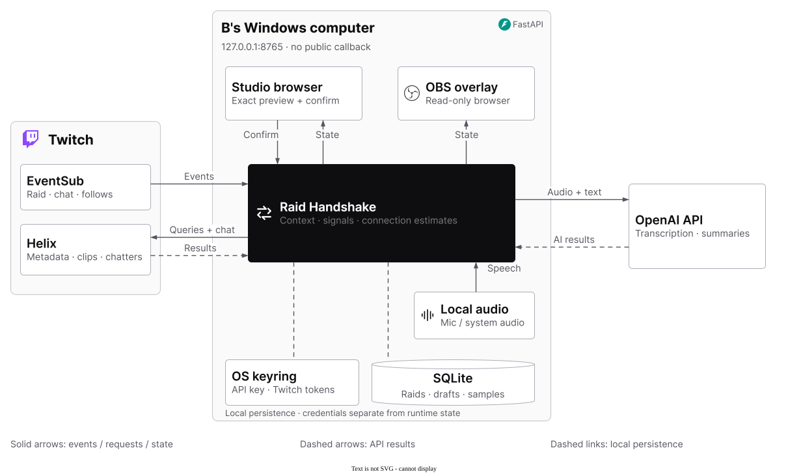
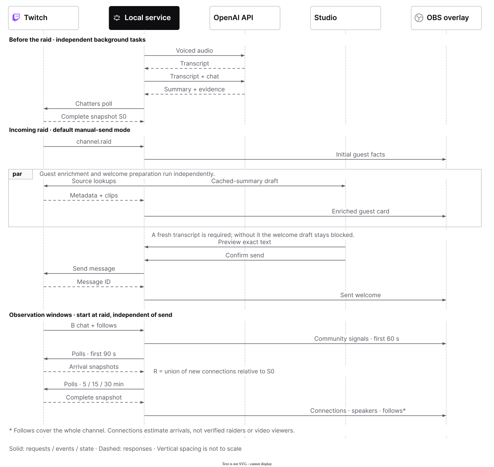

# Raid Handshake

[](https://github.com/narmi924/Raid-Handshake/actions/workflows/checks.yml)

A local studio and OBS overlay that carry context across a **real Twitch raid**.

Built with OpenAI Codex for the Codex x TwitchCon Hackathon. Runtime transcription and
summarization use the OpenAI API; there is no local model installation.

**Starting from zero?** Follow the [English judge and setup guide](docs/JUDGE_GUIDE.md).
The [accepted implementation plan](PLAN.md) records the current scope and open terms questions.

**Live-tested:** a genuine `thisisraida` → `thisisraidb` raid produced a manually approved
Twitch chat message **19.803 seconds after local EventSub receipt**. The broadcaster confirmed
the guest card appeared in the actual Twitch broadcast within 30 seconds. Real five-, fifteen-
and thirty-minute chat-connection samples have completed with an empty cohort; positive-cohort
examples remain unverified. See the [evidence and limits](docs/VERIFICATION.md).

For submission, start with the [English judge guide](docs/JUDGE_GUIDE.md),
[project description](docs/SUBMISSION.md), [demo recording script](docs/DEMO_SCRIPT.md),
and [English closeout checklist](docs/CLOSEOUT.md).

The interface follows the [supplied Twitch design reference](docs/twitch.design.md): a light
canvas, purple primary actions and pill controls. First-run setup has three steps. Daily use
focuses on listening and reviewing one welcome message; credentials, models, templates and
diagnostics live in Settings. The interface and primary submission materials are English.

Repository: [narmi924/Raid-Handshake](https://github.com/narmi924/Raid-Handshake).

## Architecture

The studio, audio capture, local service and OBS browser source run on B's Windows computer.
Twitch supplies events and channel data; OpenAI transcribes the selected local audio and
summarizes the recent spoken context. Codex is the development tool, outside this runtime path.



[Editable draw.io](docs/figures/architecture/architecture.drawio) ·
[PNG](docs/figures/architecture/architecture.png) ·
[PDF](docs/figures/architecture/architecture.pdf)

The OBS arrow carries read-only overlay state; OBS broadcasts the composed scene to Twitch
independently. [Figure sources and code references](docs/figures/README.md) document each connection.

## Run on Windows

Requirements: Windows 10/11, Python 3.11, [uv](https://docs.astral.sh/uv/getting-started/installation/),
and, when rebuilding the frontend, Node.js 24 LTS. OBS Studio runs on the receiving channel's computer.

From the repository folder, use PowerShell:

```powershell
uv sync --python 3.11 --extra dev
npm ci
npm run build
uv run raid-handshake
```

Alternatively, run `./start.ps1`; it builds the frontend if needed and starts the application.
Open **http://127.0.0.1:8765**. The production frontend is bundled and served by FastAPI.
The service deliberately binds only to localhost. It does not need a public callback or tunnel.
With the bundled interface, a runtime-only installation can use
`uv sync --python 3.11 --frozen` followed by `uv run raid-handshake`; Node is needed to rebuild.

## Connect real services

1. Register a Twitch application as a **Public Client**. Enter its Client ID in setup step 1.
   Device Code Flow needs no Client Secret. Twitch may still require a redirect entry during
   registration; `http://localhost:8765` is suitable, although DCF does not use it.
2. Select **Connect Twitch**, open the official activation link, and authorize as the
   **receiving broadcaster B**. The UI displays the connected channel. No standalone bot account
   is required: chat posts use B's identity.
3. Add your own OpenAI API key in setup step 2. Defaults are `gpt-transcribe` for bounded 8-second voiced
   audio segments and `gpt-4.1-mini` for structured Responses summaries. Models are configurable
   for your project's access. No automatic provider or local-model fallback is performed.
4. Choose an authorized audio source and select **Start listening**. Audio and chat context go to
   OpenAI. Wait for an actual transcript and a fresh summary. No title-only substitution is used.
   For speech played by a local HTML page, choose the matching speaker entry marked
   **System audio**. Keep Twitch web players muted on that computer to avoid re-capture.
   The [OBS audio guide](docs/OBS_AUDIO_SETUP.md) covers this setup.
5. In **Settings → Welcome**, configure your real participation hint, one rule, language and template. Templates support
   `{summary}`, `{commands}`, `{rule}`; the complete message must fit Twitch's 500-character limit.
6. Copy the overlay URL in setup step 3, or **Settings → Connections**, into a **1920×1080 Browser source** in B's scene. It has a transparent background.
7. Wait for a fresh Chatters baseline before triggering the raid from A. Both channels should be
   live, A should have real participants, and B's incoming-raid settings must allow A.

Scopes: `user:read:chat`, `user:write:chat`, `moderator:read:chatters`,
`moderator:read:followers`. Tokens are validated and refreshed, including rotation of public
DCF refresh tokens. They and the API key use the OS credential manager where available;
an explicitly labeled session-memory fallback is used if that service is unavailable.
Optional `OPENAI_API_KEY` and `TWITCH_CLIENT_ID` environment configuration is supported.
Keep any `.env` file private; the repository ignores it.

## What happens on a raid

- The `channel.raid` v1 event immediately creates a card with the actual source and raid size.
  Channel metadata, avatar and available recent clip titles are fetched in parallel with a
  4.5-second budget. Clip candidates come from the last seven days (up to 100 returned results),
  sorted by creation time locally; this is not a promise to have enumerated every source clip.
- A landing draft uses the receiving stream's current three-minute spoken context. Chat is
  supplementary. Summaries include actual transcript excerpts; absent or stale audio blocks
  the landing draft instead of silently replacing transcription with channel metadata.
- **Default:** view the complete text, then press **Ctrl+Shift+Enter** globally or click Send.
  The preview belongs to that exact draft revision. A send lock and persisted state prevent
  duplicate clicks/EventSub deliveries from causing duplicate posts. Unknown delivery outcomes
  are not automatically retried.
- **Optional preapproved mode:** the broadcaster approves the template's structure/fixed wording
  and explicitly enables automatic posting. It inserts the current summary and posts without a
  new per-message confirmation. This mode starts off; changing template wording, commands, rule
  or language turns it off again. The final generated text is dynamic.
- For the first 60 seconds, chat in B teaches the overlay which **source-owned native emotes**
  recur (`emote.owner_id == source broadcaster ID`). Repeated text tokens may include third-party
  emotes or catchphrases, but their identity/ownership is not verified. A candidate needs at least
  three occurrences and two distinct authors; insufficient samples are labeled explicitly.

Only the receiving channel's EventSub feed is subscribed. There is no historical source-chat
API assumption, self-report enrollment, extension approval dependency, or simulated-event route.

## Raid sequence

The default path reuses a fresh spoken summary, enriches the guest card and prepares the
welcome in parallel, then waits for the broadcaster's exact-text confirmation. Observation
windows start at the raid and do not wait for the send. Vertical spacing is schematic.



[Editable draw.io](docs/figures/raid-sequence/raid-sequence.drawio) ·
[PNG](docs/figures/raid-sequence/raid-sequence.png) ·
[PDF](docs/figures/raid-sequence/raid-sequence.pdf)

## Chat-connection estimates

The application polls **all pages** of `Get Chatters` every five seconds. It discards partial
pagination failures rather than treating them as an empty room.

- **S0** is the freshest complete snapshot preceding the raid's EventSub timestamp; its age is
  shown. A missing/stale baseline produces unknown estimates, not an empty baseline.
- **R** is the union of accounts appearing in complete snapshots within 90 seconds after the
  raid that were absent from S0. A user remains a member of R even if they subsequently leave.
- At **5/15/30 minutes**, connected = `R ∩ sampled chatters`; speech = distinct members of R
  who sent ordinary messages in the preceding five minutes. The app's own landing posts do not
  inflate speech counts. Follow events are counted **for the whole channel** since the raid.
- Actual observation timestamps are displayed. A checkpoint missed by more than 30 seconds is
  marked unknown rather than reconstructed from a later observation. EventSub gaps make affected
  message/follow metrics unknown; polling gaps and overlapping raid windows are flagged.

**R is an estimated post-raid arrival cohort, not a verified raid-member list.** Twitch's list
has update delays; chat connections do not prove video viewing. Unrelated arrivals, bots and
overlapping raids may contaminate the estimate. The overlay labels the chat-connection method
and update delay. These figures cannot demonstrate causal improvement in viewing retention.

## Data and terms

The requested implementation sends microphone audio and selected chat text to OpenAI. Explicit
chatter IDs/logins are not included as summary fields, but text can itself contain personal details.
Audio is buffered in memory, transcript/chat context is kept to a rolling window, and session
cohorts/drafts are pruned after an hour. Runtime state is ignored by Git. Diagnostic activity does
not contain raw chat or audio. Responses use `store=false`; this does **not** promise zero provider
retention or grant third-party data rights.

Twitch Developer Services Agreement VI.C covers sharing Twitch Data with third parties. Joint
sponsorship or use of Codex alone does not establish a written exception. Schedule 1.A requires a
publishing preview; approval of structure/fixed wording alone does not establish that eventual
generated text has been previewed. Cloud processing and optional dynamic auto-posting are
implemented as requested, with these interpretation/authorization questions documented rather
than represented as officially approved. See the [current agreement](https://legal.twitch.com/en/legal/developer-agreement/).

## Development and checks

```powershell
uv run pytest -q
uv run ruff check src tests
npm run build
```

Tests use isolated in-memory credentials and HTTP stubs. They validate behavior, not a real raid.
The app has no simulation button or fake raid endpoint. Local browser checks also cannot prove
that Twitch authorization, OpenAI billing/model access, or the actual A → B raid has succeeded.

Reproducing the live run requires two accounts/broadcasts, B authorization, an OpenAI API key,
and real participants for positive chat-connection observations. Existing tests do not replace
those live checks. See [verification status](docs/VERIFICATION.md) and the
[setup guide](docs/JUDGE_GUIDE.md).

## Hackathon submission

Keep the repository and run instructions accessible to judges. Record real Twitch operation,
the five-minute observation, and how Codex was used. A sub-three-minute edit may include a
clearly labeled real-time jump; do not substitute generated events. Include the main build
thread's actual Codex session ID and an English project description. The entry cutoff is
November 2, 2026, 14:00 Pacific / November 3, 2026, 06:00 Singapore.

Build thread / Codex session ID: `01a17154-fef0-76f1-b2bb-cb54cdf374ae`.
The official rules require a publicly visible YouTube demo and accessible source for judging:
[submission requirements](https://twitchcon-codex.devpost.com/rules).
